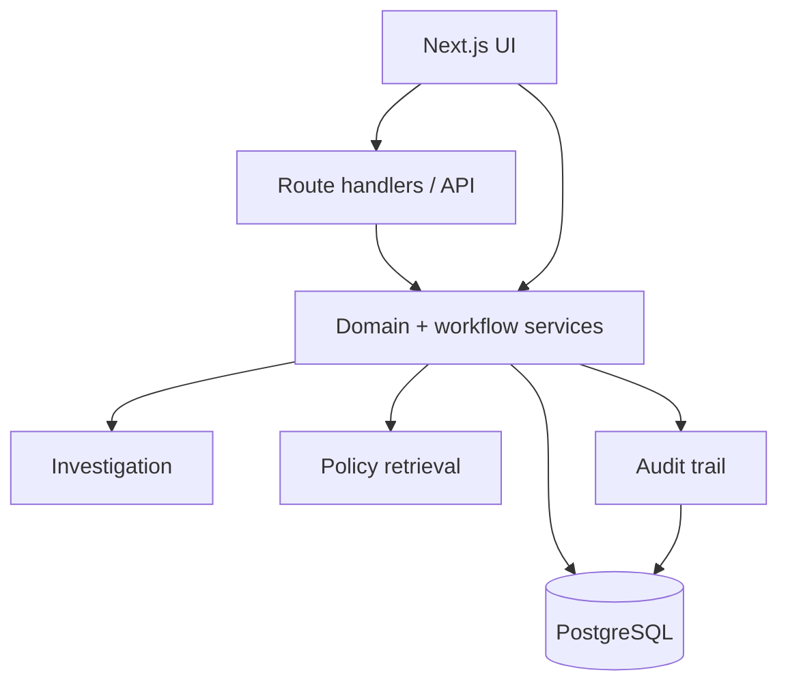

# ExceptionPilot

<p align="center">
  
</p>

<p align="center">
  <strong>Explainable invoice exception management for finance teams.</strong><br/>
  Investigate discrepancies, retrieve policy evidence, route approvals, and preserve an auditable decision trail.
</p>

## Product overview

ExceptionPilot is a finance workflow application for investigating invoice exceptions **before they become payment problems**.

It connects financial matching, risk analysis, policy evidence, human approval and auditability in one controlled workflow.

> **Scope:** ExceptionPilot is a scoped, single-tenant demonstration. It does not release payments and does not grant an AI model authority to perform financial actions.

## Core workflow

```text
Invoice exception
      │
      ▼
PO / Invoice / GRN matching
      │
      ▼
Deterministic risk factors
      │
      ▼
Version-aware policy retrieval
      │
      ▼
Investigation + evidence packet
      │
      ▼
Human approval
   ┌──┴───────┐
   ▼          ▼
Hold/task   Reject/resolve
   │          │
   └────┬─────┘
        ▼
    Audit trail
```

## Key capabilities

| Area | Capability |
|---|---|
| Investigation | Three-way matching, variance/tolerance checks, duplicate indicators and historical cases |
| Risk | Explainable deterministic risk factors |
| Policy | Version-aware active/effective policy evidence |
| Retrieval | PostgreSQL lexical retrieval with optional pgvector semantic retrieval |
| AI | Optional grounded Gemini/OpenAI generation over retrieved evidence |
| Approvals | Role-aware thresholds, separation of duties and single-use decisions |
| Workflow | Holds, procurement tasks, vendor communication drafts and SLA monitoring |
| Audit | Append-only audit trail and before/after state changes |
| Simulation | Preview sensitive workflows without mutating financial state |
| UI | Responsive workspace, themes, command search, drawers, notifications, analytics and exports |
| Security | Backend RBAC, secure sessions, CSP/security headers, upload validation and canonical-origin checks |

## AI and RAG architecture

AI is optional. The deterministic application remains usable without an external model.

The repository supports an optional grounded provider using Gemini or OpenAI. Retrieval supplies stored policy evidence; the generation layer is not permitted to execute financial actions.

```text
Policy documents
      │
      ▼
Version/effective filtering
      │
      ├── lexical retrieval
      └── optional pgvector embeddings
                │
                ▼
        Retrieved evidence
                │
                ▼
       Optional LLM generation
                │
                ▼
      Grounded investigation output
```

The retrieval confidence score is an evaluation signal, **not a calibrated probability of truth**. It should be recalibrated against a project-specific labeled set before production use.

See [RAG](docs/rag.md), [AI agent](docs/ai-agent.md) and [Evaluation](docs/evaluation.md).

## Architecture



Financial state changes are controlled by backend domain logic rather than by the UI.

## Repository structure

| Path | Purpose |
|---|---|
| `src/app` | App Router pages, API routes and health endpoints |
| `src/components` | Workspace UI and visualizations |
| `src/lib/domain.ts` | Financial rules, state transitions and permissions |
| `src/lib/actions.ts` | Controlled workflow actions |
| `src/lib/investigation.ts` | Investigation reports and evidence packets |
| `src/lib/retrieval.ts` | Version-aware policy retrieval |
| `src/db` | PostgreSQL/Drizzle database layer |
| `drizzle` | Migrations and audit enforcement |
| `scripts` | Migration, seed and administrative scripts |
| `docs` | Technical documentation |
| `public` | Brand assets |

## Quick start

### Requirements

- Node.js 22+
- npm
- PostgreSQL 17+ or compatible PostgreSQL

### Install

```bash
git clone https://github.com/aayush-as69/exceptionpilot.git
cd exceptionpilot
npm ci
cp .env.example .env
```

Set `DATABASE_URL` and keep demo mode disabled unless intentionally running the local demo.

### Database

```bash
npx tsx scripts/migrate.ts
```

### Development

```bash
npm run dev
```

Open **http://localhost:3000**.

For the optional semantic RAG provider, configure the documented `AI_PROVIDER` and corresponding API key, then build the embedding index after migrations.

## Demo mode

Demo mode is intentionally development-only.

The seeded demo accounts represent different finance roles. Do not expose demo mode or seed-on-start on an internet-facing deployment.

The demo scenario centers on **INV-1042**, where the invoice exceeds the purchase-order tolerance and requires an explainable investigation path.

## API and health endpoints

| Endpoint | Purpose |
|---|---|
| `/workspace/api-docs` | Interactive API browser |
| `/api/openapi` | OpenAPI 3.0 JSON |
| `/health` | Database connectivity health |
| `/ready` | Readiness check |
| `/api/health` | Application health |

Full behavior and permissions are documented in [API](docs/api.md).

## Validation and testing

CI covers dependency installation, dependency auditing, security-policy regression tests, route type generation, linting, TypeScript checks and the production build.

The validation suite is **not** a substitute for PostgreSQL integration testing, browser/accessibility verification, formal retrieval evaluation, Docker runtime testing, cloud deployment testing or an independent security review.

See [Testing](docs/testing.md) and [Validation](VALIDATION.md).

## Security model

Protected operations are enforced on the backend.

Important boundaries include:

- no anonymous fallback for protected routes
- backend RBAC and permission checks
- digest-only session tokens
- HTTP-only SameSite cookies
- canonical-origin validation
- security headers/CSP
- upload validation
- masked sensitive identifiers
- append-only audit enforcement
- development-only demo role selection

AI retrieval and generation never bypass approval authority.

See [Security](docs/security.md) and [Threat model](docs/threat-model.md).

## Deployment

A multi-stage Dockerfile and development Compose setup are included.

For production, explicitly configure:

- `APP_ENV=production`
- `DEMO_MODE=false`
- `SEED_ON_START=false`
- canonical `APP_ORIGIN`
- strong database credentials
- HTTPS/TLS
- controlled administrator provisioning
- backups and restore testing
- a real distributed rate-limiting layer if required by the deployment

See [Deployment](docs/deployment.md).

## Documentation

| Guide | Purpose |
|---|---|
| [Documentation index](docs/README.md) | Complete guide map |
| [Architecture](docs/architecture.md) | System boundaries |
| [Database](docs/database.md) | Schema and migrations |
| [Workflows](docs/workflows.md) | Investigation and approval |
| [AI agent](docs/ai-agent.md) | AI provider boundary |
| [RAG](docs/rag.md) | Retrieval and embeddings |
| [Evaluation](docs/evaluation.md) | Grounding evaluation |
| [Security](docs/security.md) | Security controls |
| [Threat model](docs/threat-model.md) | Security analysis |
| [API](docs/api.md) | Endpoint behavior |
| [Testing](docs/testing.md) | Verification |
| [Features](docs/features.md) | Implemented vs planned |
| [Deployment](docs/deployment.md) | Deployment guidance |
| [Validation](VALIDATION.md) | Recorded checks |

## Project status

**Functional demonstration / development**

ExceptionPilot's core value is not autonomous finance automation. It is the combination of deterministic financial checks, version-aware evidence retrieval, permission-controlled human decisions and an auditable workflow.

The next production-oriented steps are stronger integration coverage, formal retrieval evaluation, durable background jobs, SSO/MFA, tenant isolation, object storage and independent security review.

## License

MIT License. See [LICENSE](LICENSE).