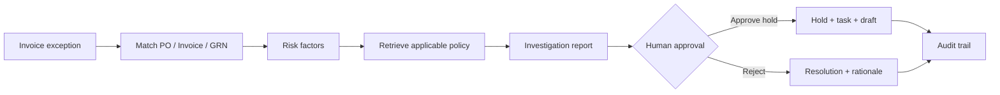
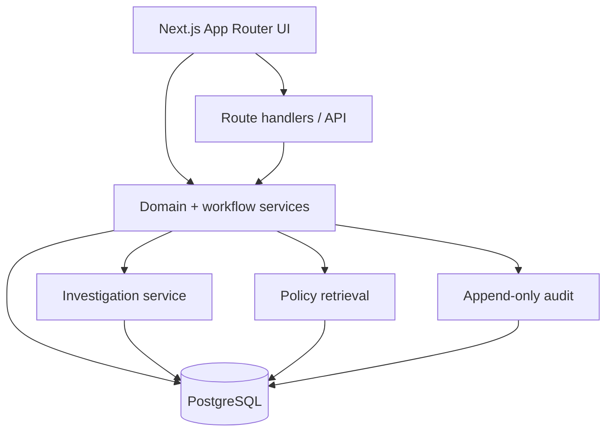

# ExceptionPilot

<p align="center">
  
</p>

<h1 align="center">ExceptionPilot</h1>

<p align="center">
  <strong>Explainable invoice exception management for finance teams.</strong><br/>
  Investigate discrepancies, retrieve policy evidence, route approvals, and preserve an auditable decision trail.
</p>

<p align="center">
  <a href="https://github.com/aayush-as69/exceptionpilot/actions"></a>
  <a href="https://github.com/aayush-as69/exceptionpilot"></a>
  
  
  
  
</p>

---

## What is ExceptionPilot?

ExceptionPilot is a finance workflow application for investigating **invoice exceptions** before they become payment problems.

It brings together:

- 🔎 **Exception investigation** — compare PO, invoice, and goods-receipt data.
- ⚖️ **Explainable risk scoring** — show the factors behind a risk result.
- 📚 **Policy evidence** — retrieve the applicable policy version and source excerpt.
- 👤 **Human approval** — enforce role authority and separation of duties.
- 🧾 **Auditability** — record decisions and before/after state changes.
- 🧪 **Simulation** — preview sensitive workflows without mutating financial state.
- 📊 **Analytics** — monitor exposure, risk, SLAs, root causes, and resolution trends.

> **Important:** ExceptionPilot is a scoped, single-tenant demonstration. It is not an autonomous payment system and does not release payments.

## Demo scenario

The seeded investigation centers on **INV-1042**:

| Field | Value |
|---|---:|
| Purchase order | ₹1,10,000 |
| Invoice | ₹1,24,000 |
| Variance | ₹14,000 |
| Variance % | 12.73% |
| Policy tolerance | 5% |

The workflow makes the decision path visible instead of hiding it behind an AI-generated answer.

---

## Product flow



Every sensitive mutation is authorized on the backend. Investigation and simulation remain read-only.

---

## Key capabilities

### Investigation
- Three-way matching checks
- Exact integer-minor-unit financial calculations
- Variance and tolerance analysis
- Duplicate and near-duplicate indicators
- Historical case lookup
- Deterministic investigation reports
- Traceable evidence excerpts

### Policy retrieval
- Active/effective/unexpired policy filtering
- PostgreSQL full-text ranking
- Transparent lexical overlap
- Version-aware source metadata
- Exact stored excerpts
- Draft → activation → archive lifecycle

### Workflow
- Role-aware approval thresholds
- Separation of duties
- Single-use approval decisions
- Invoice holds
- Procurement follow-up tasks
- Vendor communication drafts
- SLA monitoring and escalation
- Idempotent workflow events

### Security
- scrypt password hashing
- Digest-only session tokens
- HTTP-only SameSite cookies
- Production HTTPS cookie enforcement
- Backend RBAC and permission checks
- Canonical-origin validation using `APP_ORIGIN`
- No anonymous fallback for protected routes
- Explicit development-only demo role selection
- Role-based workspace data projections
- Security headers/CSP
- Upload validation
- Masked sensitive identifiers
- Append-only audit trigger

### UI
- Responsive workspace layout (independent mobile-browser verification remains outstanding)
- Light/dark themes
- Command search (`Ctrl/Cmd + K`)
- Notifications
- Record drawers and detail views
- CSV/JSON/PDF exports
- Analytics and risk heatmaps

---

## AI architecture

ExceptionPilot deliberately does **not** pretend to use an external LLM.

The default provider remains deterministic for offline/demo operation, but the repository now supports an **optional grounded semantic-RAG provider** using Gemini or OpenAI. Configure `AI_PROVIDER` and the corresponding API key to enable it.

It reads real application records and stored policy evidence, performs deterministic checks, and returns structured findings.

It does **not**:

- call OpenAI or Gemini unless explicitly configured;
- generate fake citations;
- store hidden chain-of-thought;
- execute financial actions;
- claim calibrated model confidence.

The copilot is permission-aware and evidence-driven. The external provider is restricted to grounded generation over retrieved evidence; autonomous financial actions remain disabled.

See [AI architecture](docs/ai-agent.md).

---

## Retrieval / RAG

The retrieval layer is intentionally transparent.

```text
Policy sources
    │
    ├── document + version metadata
    ├── section / page
    └── exact source text
            │
            ▼
   Active + effective filter
            │
            ▼
 PostgreSQL ranking + lexical overlap
            │
            ▼
      Stored source excerpt
```

This is now **semantic vector RAG with a lexical fallback**. Active policy chunks can be embedded into PostgreSQL `pgvector`, retrieved by cosine similarity, and supplied to an optional grounded Gemini/OpenAI generation step.

The system reports a versioned calibrated retrieval-grounding confidence score, but this is not a probability of truth and should be re-calibrated against a project-specific labeled evaluation set before production use.

See [retrieval](docs/rag.md) and [evaluation](docs/evaluation.md).

---

## Architecture



See [architecture](docs/architecture.md).

---

## Repository guide

| Path | Purpose |
|---|---|
| `src/app` | Pages, route handlers, health/readiness endpoints |
| `src/components` | Workspace UI, charts, queues, drawers, settings |
| `src/lib/domain.ts` | Financial logic, risk rules, state transitions, permissions |
| `src/lib/actions.ts` | Controlled workflows and monitoring |
| `src/lib/investigation.ts` | Investigation reports and evidence packets |
| `src/lib/retrieval.ts` | Version-aware policy retrieval |
| `src/db` | PostgreSQL connection and schema |
| `drizzle` | Database migrations and audit enforcement |
| `scripts` | Migration, seed, packaging, and admin provisioning |
| `docs` | Architecture, security, API, workflow, testing, and deployment docs |
| `public` | Brand assets and static files |

---

## Screenshots & visual documentation

The repository currently contains no captured runtime screenshots. Rather than inventing screenshots, this documentation uses Mermaid diagrams and a dedicated visual-documentation guide.

For a real deployment, capture these four views and place them in `docs/screenshots/`:

1. **Overview** — dashboard metrics, priority queue, risk distribution.
2. **Investigation** — INV-1042 matching, risk factors, and policy evidence.
3. **Approval** — approval decision, authority checks, and confirmation.
4. **Audit** — final decision, timeline, evidence export, and resolution feedback.

See [screenshot guide](docs/screenshots.md).

---

## Local setup

### Requirements

- Node.js 22+
- npm
- PostgreSQL 17+ or a compatible PostgreSQL instance

### 1. Clone

```bash
git clone https://github.com/aayush-as69/exceptionpilot.git
cd exceptionpilot
```

### 2. Install

```bash
npm ci
```

### 3. Configure environment

```bash
cp .env.example .env
```

Set `DATABASE_URL` for your PostgreSQL instance. The example keeps `DEMO_MODE=false` and `SEED_ON_START=false`. To intentionally run the seeded demo locally, set `APP_ENV=development`, `DEMO_MODE=true`, and `SEED_ON_START=true`. Demo mode is not for internet-facing deployments.

### 4. Prepare the database

For a fresh database:

```bash
npx tsx scripts/migrate.ts
```

When demo mode is explicitly enabled, the development seed is initialized automatically. Do not manually seed demo users into a production database.

### 5. Start the app

```bash
npm run dev
```

Open `http://localhost:3000`.\n\nFor semantic RAG, use `AI_PROVIDER=gemini` or `AI_PROVIDER=openai` and run the embedding index command after migrations. Without provider configuration, the application safely falls back to transparent lexical retrieval.

---

## Demo accounts

> These credentials are for development/demo mode only.

All seeded accounts use:

`Demo!Pilot2026`

| User | Role |
|---|---|
| Jamie Chen | AP Clerk |
| Sarah Miller | AP Manager |
| David Park | Finance Manager |
| Alex Morgan | Finance Director |
| Priya Sharma | Procurement |
| Olivia Wilson | Compliance |
| James Taylor | Auditor |
| Taylor Reed | Administrator |

Disable demo mode and seed-on-start before using non-demo data.

---

## API

Open:

- `/workspace/api-docs` — interactive endpoint browser
- `/api/openapi` — OpenAPI 3.0 JSON
- `/health` — PostgreSQL connectivity check
- `/ready` — database/readiness check (may initialize the explicitly enabled demo seed)
- `/api/health` — application health

See [API reference](docs/api.md).

---

## Validation

CI now includes dependency installation from the lockfile, a separate dependency audit, security-policy regression tests, Next.js route type generation, linting, TypeScript checks, and a production build. Results must be tied to the exact commit in [VALIDATION.md](VALIDATION.md). This suite is not a substitute for PostgreSQL integration, browser accessibility, formal retrieval evaluation, Docker runtime, or cloud deployment tests.

---

## Deployment

A multi-stage Dockerfile and development Docker Compose setup are included.

```bash
docker compose up --build
```

For non-demo deployment:

- `APP_ENV=production`
- `DEMO_MODE=false`
- `SEED_ON_START=false`
- `APP_ORIGIN=https://your-canonical-host.example`
- `CRON_SECRET` with at least 24 random characters
- `RATE_LIMITING_MODE=gateway` with an actually configured distributed rate limiter at a trusted edge gateway
- strong database credentials
- HTTPS/TLS
- controlled administrator provisioning
- backups and restore testing

See [deployment](docs/deployment.md).

---

## Documentation

| Document | Covers |
|---|---|
| [Architecture](docs/architecture.md) | System boundaries and request flow |
| [Database](docs/database.md) | Schema, migrations, financial precision |
| [Workflows](docs/workflows.md) | Investigation, approval, holds, tasks |
| [AI agent](docs/ai-agent.md) | Deterministic investigation provider |
| [Retrieval](docs/rag.md) | Policy evidence and retrieval |
| [Security](docs/security.md) | Authentication and authorization controls |
| [Threat model](docs/threat-model.md) | Assets, boundaries, mitigations, residual risks |
| [API](docs/api.md) | Endpoint behavior and permissions |
| [Testing](docs/testing.md) | Current validation/testing boundary |
| [Evaluation](docs/evaluation.md) | RAG and AI evaluation status |
| [Features](docs/features.md) | Implemented vs. future functionality |
| [Deployment](docs/deployment.md) | Local, Docker, and production guidance |
| [Validation](VALIDATION.md) | Checks actually performed |

---

## Project status

**Status: functional demonstration / development**

The strongest part of ExceptionPilot is its explicit workflow model: deterministic financial checks, version-aware policy evidence, backend authorization, human approval, simulation, and auditability are designed to work together.

The next production-oriented steps are automated tests, formal retrieval evaluation, external integrations, durable background jobs, SSO/MFA, tenant isolation, object storage/malware scanning, observability, and an independent security review.

---

## License

MIT License. See [LICENSE](LICENSE).
