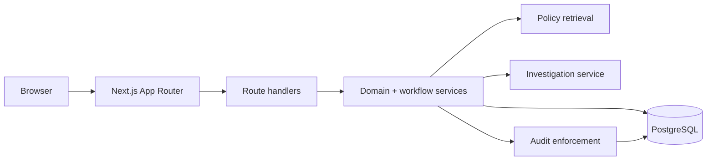

# Architecture

ExceptionPilot uses a **Next.js App Router + TypeScript + PostgreSQL/Drizzle** architecture.

The design keeps sensitive financial decisions deterministic and server-authorized while allowing the UI to present investigation and workflow context clearly.

## High-level flow

## Responsibilities

| Layer | Responsibility |
|---|---|
| `src/app` | Pages, route handlers, health/readiness |
| `src/components` | UI, charts, queues, drawers, settings |
| `src/lib/domain.ts` | Financial rules, state transitions, permission registry |
| `src/lib/actions.ts` | Controlled mutations and monitoring |
| `src/lib/investigation.ts` | Structured findings and evidence packets |
| `src/lib/retrieval.ts` | Active/effective policy retrieval |
| `src/db` | PostgreSQL connection and schema |
| `drizzle` | Migrations and audit trigger |
| `scripts` | Operational tooling |

## Request lifecycle

1. A server component or client action requests workspace data.
2. Authentication identifies the current session.
3. Backend permissions are evaluated.
4. Route handlers validate input.
5. Domain services perform deterministic checks.
6. Database operations use Drizzle and transactions where required.
7. Sensitive transitions acquire row locks and re-check authorization.
8. Audit events capture the relevant state change.
9. The UI receives a bounded, permission-filtered result.

The browser never acts as the final authority for a sensitive operation.

## Financial correctness

Amounts are stored as integer paise. Tolerance comparisons avoid floating-point arithmetic by using cross-multiplication.

## AI boundary

The current investigation provider is `mock / deterministic-rules-v1`.

It reads real application data and policy evidence but has no executable financial tool authority. The application does not simulate an external LLM or claim model-generated reasoning.

## Deployment boundary

This is a single-tenant demonstration. PostgreSQL is the primary external dependency. Production deployment would require stronger tenant isolation, secret management, observability, backup/restore controls, and independent security review.
