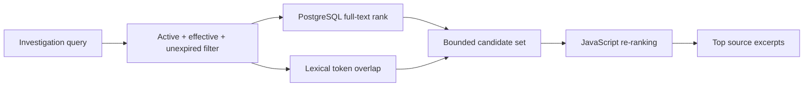

# Retrieval

ExceptionPilot uses transparent policy retrieval rather than opaque semantic search.

## Source model

Policy chunks retain document ID, title/version, section, page, category, and exact source text.

## Retrieval flow

The current implementation retrieves at most 100 database candidates ordered by PostgreSQL full-text rank, combines that rank with lexical overlap in JavaScript, and returns up to five excerpts. Ranking is bounded by that candidate set; relevant documents outside the candidate set can be missed.

Draft, archived, inactive, and expired sources are excluded from normal evidence retrieval.

## Scores and citations

Returned excerpts are stored source text. The `matchStrength` field is a lexical token-overlap ratio. It is not embedding similarity, semantic confidence, calibrated probability, or a probability that an answer is correct.

The system does not invent citations or rewrite an excerpt and present it as an original policy statement.

## What this is not

This is **not embedding-based semantic RAG**. The repository does not implement OpenAI/Gemini inference, embedding generation, pgvector, a vector database, a semantic reranker, or external semantic retrieval APIs.

## Evaluation

Retrieval quality is not represented by an invented percentage. A valid benchmark should contain labeled expected evidence and measure recall, precision, citation correctness, and grounding. The current implementation is a transparent prototype and requires a formal evaluation before production use.

See [evaluation](evaluation.md).
