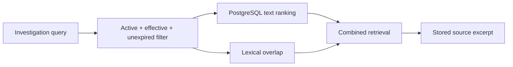

# Retrieval

ExceptionPilot uses transparent policy retrieval rather than opaque semantic search.

## Source model

Policy chunks retain:

- document ID
- title/version
- section
- page
- category
- exact source text

## Retrieval flow

Draft, archived, inactive, and expired sources are excluded from normal evidence retrieval.

## Citation behavior

Returned excerpts are stored source text.

The system does not invent citations or rewrite an excerpt and present it as an original policy statement.

## What this is not

This is **not embedding-based semantic RAG**.

The repository does not implement pgvector, embedding providers, reranker models, or external semantic retrieval APIs.

## Evaluation

Retrieval quality is not represented by an invented percentage.

A valid benchmark should contain labeled expected evidence and measure at least retrieval recall, precision, citation correctness, and grounding.

See [evaluation](evaluation.md).
